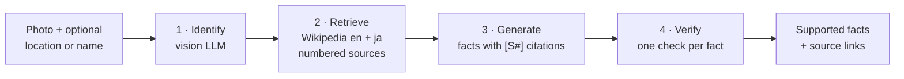

# VisLoc-RAG

**Photo in → cited, fact-checked facts out.**

[](https://github.com/agrawaladitya270/VisLoc-RAG/actions/workflows/ci.yml)


[](LICENSE)

<p align="center">
  
</p>

Take a photo of a landmark, building, dish or object. VisLoc-RAG identifies it with a vision LLM,
retrieves evidence from **English and Japanese Wikipedia**, writes up to five facts that **cite their
sources**, and then **verifies each fact** against the sources it cites. Only verified facts are returned,
each with a link to where it came from.


*Real output for a photo of Tokyo Skytree (the photo itself is not shown). Each `[S#]` links to the
Wikipedia article that supports the fact.*

**Stack:** Python · Groq (Qwen3.8 27B for vision and checking, GPT-OSS 120B for writing) · Wikipedia API ·
FastAPI · Docker · GitHub Actions · pytest · ruff

## How it works



1. **Identify:** a vision model names the subject and its category and writes an encyclopedia search
   query. The user's location goes in as a hint. If the user types a name, this step is skipped.
2. **Retrieve:** the top English Wikipedia articles, plus the Japanese version of the best match found
   through Wikipedia's own language link, which is more precise than searching Japanese Wikipedia with
   English words. It takes 3 API requests per photo, which keeps it inside Wikipedia's rate limits. Each
   article becomes a numbered source (`S1`, `S2`, …). Japanese text goes to the model as-is, with no
   lossy round-trip translation.
3. **Generate:** a text model writes up to 5 specific facts using *only* those sources. Each fact lists
   the source ids that support it. If the sources are about something else, it returns no facts.
4. **Verify:** a separate call per fact asks whether the claim is supported by the sources it cites.
   The checker is a different model family from the writer, so the two are less likely to make the
   same mistake. A fact with no valid citation fails automatically. Only supported facts are shown.

## Design decisions

- **Grounding is checked, not just requested.** Telling a model to "use the sources" does not make it
  do so. Requiring citations and checking each claim on its own makes unsupported facts detectable and
  filterable.
- **Structured evidence instead of scraping.** The Wikipedia API returns clean text with stable URLs,
  so every fact shown links back to its evidence.
- **Multilingual retrieval.** Japanese landmarks often have more detailed Japanese articles. The model
  reads them directly.
- **Built to be measured.** Every run records per-stage latency and token usage. An evaluation harness
  measures identification accuracy, verified-fact rate, and how often the verifier agrees with human
  labels.
- **Production basics.** Keys come only from the environment. Network calls have timeouts and
  retries. Uploads are size-limited and validated, with clear 400/413/503 errors. The image is a slim,
  multi-stage, non-root Docker build. CI runs lint, offline tests on 3 Python versions, and a Docker
  build.

## Quickstart

```bash
git clone https://github.com/agrawaladitya270/VisLoc-RAG.git
cd VisLoc-RAG
pip install -r requirements.txt
cp .env.example .env          # then put your Groq key in .env (free at console.groq.com); never commit it
uvicorn visrag.api:app --port 8000 --env-file .env
```

Open <http://localhost:8000> for the web page: choose a photo, optionally add your location, and get
the verified facts with links to their sources. If the photo is identified wrongly, type the correct
name in the Name field and run it again. API docs are at `/docs`. Or call the API directly:

```bash
curl -F "file=@photo.jpg" -F "location=Kyoto" http://localhost:8000/facts
curl -F "file=@photo.jpg" -F "name=Asahi Beer Hall" http://localhost:8000/facts   # skip identification
```

Response shape:

```jsonc
{
  "subject": {"name": "...", "category": "landmark", "search_query": "...", "confidence": "high"},
                                       // or {"name": "...", "named_by_user": true} when a name was typed
  "facts":   [{"fact": "...", "sources": ["S1"], "supported": true}],
  "facts_checked": 5,   // facts written before verification; "facts" holds only those that passed
  "sources": [{"id": "S1", "title": "... (en)", "url": "https://en.wikipedia.org/wiki/..."}],
  "timing":  {"identify_s": ..., "search_s": ..., "facts_s": ..., "check_s": ..., "total_s": ...}
}
```

**From Python**

```python
from visrag.pipeline import run

result = run(open("photo.jpg", "rb").read(), location="Kyoto")   # or name="Kinkaku-ji" to skip identify
for f in result["shown_facts"]:
    print(f["fact"], f["sources"])
```

**With Docker**

```bash
docker build -t visloc-rag .
docker run --env-file .env -p 8000:8000 visloc-rag
```

| Environment variable | Default | Purpose |
|---|---|---|
| `GROQ_API_KEY` | (required) | Groq API key |
| `VISRAG_VISION_MODEL` | `qwen/qwen3.8-27b` | identifies the photo |
| `VISRAG_TEXT_MODEL` | `openai/gpt-oss-120b` | writes the cited facts |
| `VISRAG_CHECK_MODEL` | `qwen/qwen3.8-27b` | checks each fact against its sources |

## Evaluation

`eval/run_eval.py` runs the full pipeline on a labeled landmark set and reports:

- **Identification accuracy**: the predicted name matches the title or an alias. Matching ignores
  accents and case and accepts Japanese names, so *Tōdai-ji* = *Todai-ji temple* and *Kinkaku-ji* =
  *金閣寺*.
- **Facts per image** and **verified-fact rate**
- **Images with at least one unsupported fact**
- **p50 / p95 latency** and **tokens per image**
- **Ablation:** with and without the location hint (`--no-location`)
- **Human check:** 30 random facts and their evidence are exported to CSV for hand labeling, to measure
  how often the automatic verifier agrees with a person

`eval/landmarks.csv` has 58 landmarks (33 in Japan, 25 worldwide) with aliases and locations. The
script downloads each article's lead image from Wikipedia as the test photo.

```bash
python eval/run_eval.py --out results/all.json                                 # all 58 landmarks
python eval/run_eval.py --sample 30 --seed 0 --sleep 45 --out results/sample30.json   # fixed random 30
python eval/run_eval.py --no-location --out results/no_location.json           # ablation
```

On Groq's free tier the limit is 8,000 tokens per minute per model, and one photo uses about that much,
so `--sleep 45` keeps a run inside it.

## Tests

```bash
pip install -r requirements-dev.txt
ruff check . && pytest -q
```

The tests need no network or API key. A fake model client checks that uncited or unsupported facts are
hidden, that model JSON is parsed safely, and that name matching handles aliases and accents. Retrieval
tests check that the Japanese article comes from the language link and that a Wikipedia rate limit is
reported as such, not as "no results". API tests cover upload validation, the missing-key and
rate-limit errors, and that source text never leaks into responses.

## Project structure

```
visrag/
  pipeline.py      identify → retrieve → generate → verify
  api.py           FastAPI service: POST /facts, GET /health, web page at /
  static/          the web page (plain HTML and JS, no build step)
eval/
  run_eval.py      evaluation harness and human-label export
  landmarks.csv    58 labeled landmarks with aliases
tests/             offline tests (fake LLM client, stubbed pipeline)
Dockerfile         multi-stage, non-root image
.github/workflows  CI: ruff + pytest on Python 3.10–3.13 + Docker build
```

## Limitations and next steps

- **The verifier is an LLM too.** It uses a different model family from the writer to reduce shared
  mistakes, but it can still be wrong, which is why the evaluation measures its agreement with human
  labels. Next step: compare against an NLI model as the verifier.
- **The vision model does not know every landmark.** On a photo of the Asahi Beer Hall in Tokyo it
  answered "Golden Teapot", and it stayed wrong when given the location or a list of nearby Wikipedia
  places. When this happens, typing the name in the Name field skips identification. Next step: a
  stronger vision model behind the same interface.
- **Wikipedia lead images are well-known photos**, which makes the benchmark easier than real phone
  photos. Next step: add a set of personal photos with known answers.
- **Coverage is limited to Wikipedia.** Subjects without an article return no facts. This is by design:
  no evidence means no claims.

## History

`v0.1.0` was the original single-notebook prototype ([view it](https://github.com/agrawaladitya270/VisLoc-RAG/tree/v0.1.0)).
`v0.2.0` restructured it into a tested package and API, switched retrieval to the Wikipedia API, and
added citations with per-fact verification.
`v0.3.0` added the web page and the Name field, moved to models Groq still serves (with a checker from a
different model family than the writer), and found Japanese articles through language links.

## License

[MIT](LICENSE)
